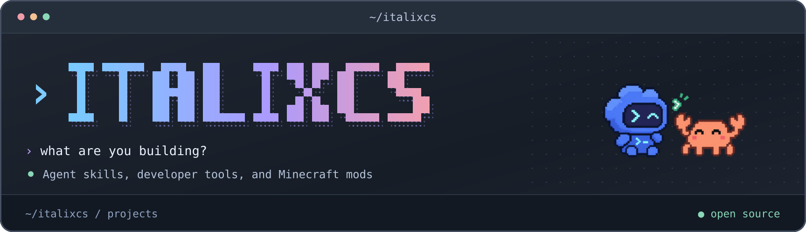
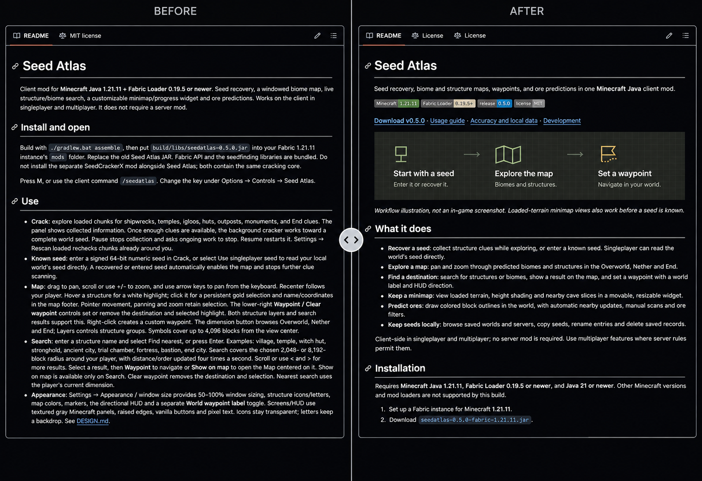
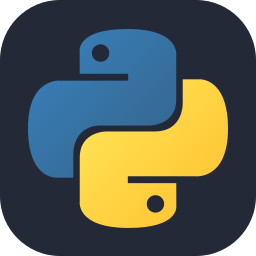
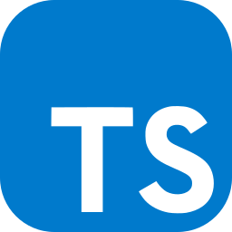

# italixcs

I build open-source skills for AI coding agents and tools for development, documentation, and Minecraft.

## Projects

### [Repo Cleaner](https://github.com/italixcs/Repo-cleaner)

An agent skill for improving GitHub READMEs, install guides, and examples. It audits the repository first so the presentation reflects what the project can actually do.

[Install](https://github.com/italixcs/Repo-cleaner/blob/main/docs/installation.md) · [Usage](https://github.com/italixcs/Repo-cleaner/blob/main/docs/usage.md) · [Releases](https://github.com/italixcs/Repo-cleaner/releases)

See the Seed Atlas README before and after

*Static, AI-composited comparison based on screenshots. The slider handle is decorative.*

### More agent skills

- [**Project Memory**](https://github.com/italixcs/Project-memory) helps agents recover project decisions, pending work, and verified context across sessions. [Install](https://github.com/italixcs/Project-memory/blob/main/docs/compatibility.md).
- [**Doc Designer**](https://github.com/italixcs/Doc-Designer) guides agents through designing and reviewing Word documents and PDFs. [Skill instructions](https://github.com/italixcs/Doc-Designer/blob/main/skills/doc-designer/SKILL.md).
- [**Skill Development**](https://github.com/italixcs/Skill-development) gives agents a workflow for researching, testing, and preparing skills for release. [Install](https://github.com/italixcs/Skill-development/blob/main/docs/installation.md).
- [**Personal README**](https://github.com/italixcs/Personal-README-skill) creates and audits GitHub profile READMEs around a developer’s public work.

### [Seed Atlas](https://github.com/italixcs/seedatlas)

A Fabric mod for Minecraft Java with seed recovery, biome and structure maps, waypoints, and ore predictions. [Downloads](https://github.com/italixcs/seedatlas/releases) · [Usage](https://github.com/italixcs/seedatlas/blob/main/docs/usage.md).

## Toolbox

## GitHub activity

**7 public repos** · **4 total stars** 
Public GitHub snapshot from 18 November 2026.

[GitHub contributions](https://github.com/italixcs?tab=overview) · [All repositories](https://github.com/italixcs?tab=repositories)
