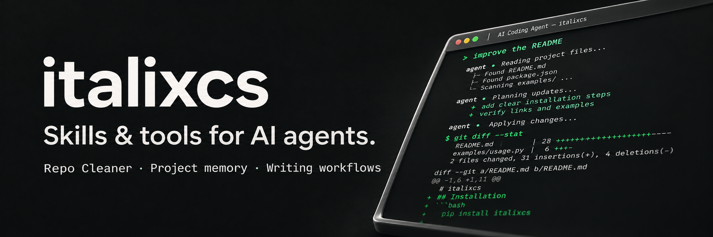
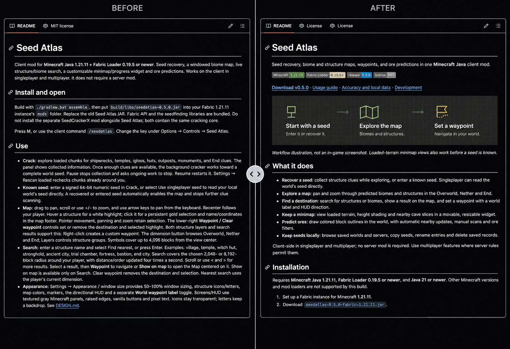

  

# italixcs

**Developer building skills and tools for frontier AI models.**

I’m focused on reusable agent skills, project memory, and workflows for writing and study. I want to build useful tools, document how they work, and keep improving them in public.

## Currently building

### [Repo Cleaner](https://github.com/italixcs/Repo-cleaner)

A skill that helps AI agents improve how a GitHub repository presents its work: the README, examples, installation guides, visuals, and repository metadata.

It checks claims against the project’s files, flags gaps, and organizes the README around what a reader needs to understand and try the project. You can ask for an audit first or have it implement the changes.

The latest update adds guidance for using GitHub callouts sparingly, so useful details are easier to spot without cluttering the README.

[Repository](https://github.com/italixcs/Repo-cleaner) · [Installation](https://github.com/italixcs/Repo-cleaner/blob/main/docs/installation.md) · [Usage](https://github.com/italixcs/Repo-cleaner/blob/main/docs/usage.md) · [Latest release](https://github.com/italixcs/Repo-cleaner/releases/latest)

### See it in practice

*Seed Atlas, my Minecraft Java mod. Static, AI-composited comparison from supplied screenshots; the center handle is decorative.*

[Before-and-after details](https://github.com/italixcs/Repo-cleaner/blob/main/docs/examples/seedatlas.md) · [Audit example](https://github.com/italixcs/Repo-cleaner/blob/main/docs/examples/notes-app-audit.md) · [Validation](https://github.com/italixcs/Repo-cleaner/blob/main/docs/validation.md)

---

[All repositories](https://github.com/italixcs?tab=repositories) · [GitHub activity](https://github.com/italixcs?tab=overview)
