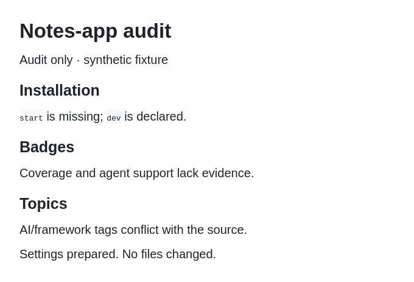

  

# italixcs

**Developer building skills and tools for frontier AI models.**

I’m focused on reusable agent skills, project memory, and workflows for writing and study. I want to build useful tools, document how they work, and keep improving them in public.

## Currently building

### [Repo Cleaner](https://github.com/italixcs/Repo-cleaner)

A skill that helps AI agents improve how a GitHub repository presents its work: the README, examples, installation guides, visuals, and repository metadata.

It checks claims against the project’s files, flags gaps, and organizes the README around what a reader needs to understand and try the project. You can ask for an audit first or have it implement the changes.

[Repository](https://github.com/italixcs/Repo-cleaner) · [Installation](https://github.com/italixcs/Repo-cleaner/blob/main/docs/installation.md) · [Usage](https://github.com/italixcs/Repo-cleaner/blob/main/docs/usage.md) · [Latest release](https://github.com/italixcs/Repo-cleaner/releases/latest)

See Repo Cleaner in practice

In an audit of a synthetic notes-app fixture, Repo Cleaner found an installation command missing from the manifest, unsupported coverage and agent-support badges, and topics that did not match the source.

  

*Condensed audit output, rendered locally. This was an audit only; no files or settings were changed.*

[Read the input and findings](https://github.com/italixcs/Repo-cleaner/blob/main/docs/examples/notes-app-audit.md) · [Validation record](https://github.com/italixcs/Repo-cleaner/blob/main/docs/validation.md)

---

[All repositories](https://github.com/italixcs?tab=repositories) · [GitHub activity](https://github.com/italixcs?tab=overview)
