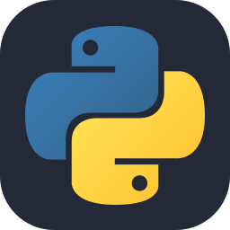
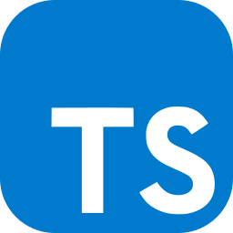
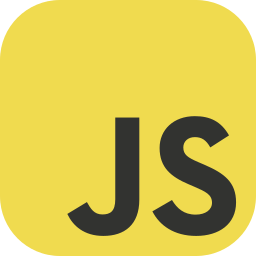
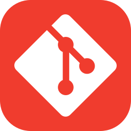
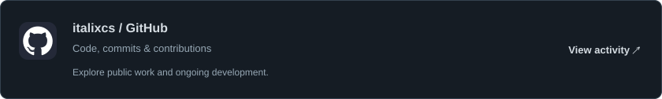

<h1 align="center">italixcs</h1>

<strong>Developer.</strong>

Building, creating, and contributing skills and tools for frontier AI models.

<h2>AI &amp; development</h2>

<h3 align="center">Toolbox</h3>

<h2>Current focus</h2>
<table><tr><td width="50%" valign="top">&nbsp; <strong>Agent skills</strong>  Reusable instructions for practical AI workflows.</td><td width="50%" valign="top">&nbsp; <strong>Project memory</strong>  Context that helps agents pick up where they left off.</td></tr><tr><td width="50%" valign="top">&nbsp; <strong>Writing &amp; study</strong>  Tools for clearer writing and structured learning.</td><td width="50%" valign="top">&nbsp; <strong>Developer tools</strong>  Small utilities that make building easier.</td></tr></table>

<h2>GitHub activity</h2>

<a href="https://github.com/italixcs?tab=overview"><picture><source media="(prefers-color-scheme: dark)" srcset="./assets/activity-dark.svg"><source media="(prefers-color-scheme: light)" srcset="./assets/activity-light.svg"></picture></a>

